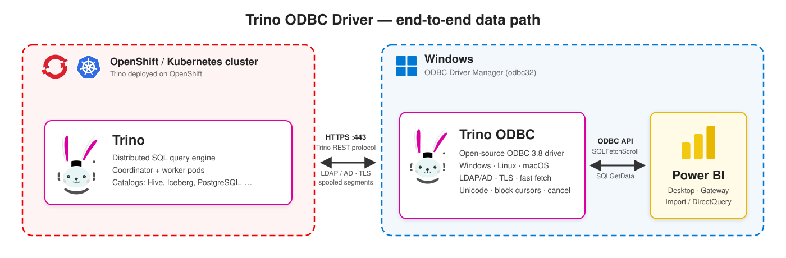

# Trino ODBC Driver

[](https://github.com/AhmetFurkanDEMIR/TrinoODBC/releases/latest)
[](LICENSE)


Türkçe: [README.tr.md](README.tr.md)

An ODBC 3.8 driver for [Trino](https://trino.io/), written from scratch in C++17, with ANSI and
Unicode entry points. The main goal is first-class support for Power BI Desktop and the Power BI
Gateway. It also works with other ODBC clients such as Excel, Tableau, pyodbc and `isql`.

> **Status.** The released packages have been installed and used on all three platforms: Windows
> x64 (NSIS installer, Windows driver manager, Power BI Desktop), Linux (`.deb` / `.rpm` /
> `.tar.gz`, unixODBC) and macOS (`.pkg`, iODBC), covering installation, DSN, connection and
> queries.

## Architecture



## Features

* **ODBC 3.8**: every core, level 1 and level 2 function in ANSI and `W` (Unicode) form, real
  descriptors (ARD/APD/IRD/IPD), block cursors with column-wise and row-wise binding, chunked
  `SQLGetData`, data-at-execution parameters (`SQLParamData` / `SQLPutData`) and the full
  conversion matrix. Cursors are forward-only and read-only.
* **Authentication**: none, LDAP / Active Directory (HTTP Basic over TLS), JWT, Kerberos (SPNEGO),
  OAuth2 (external browser flow) and client certificates (mTLS).
* **TLS**: `Full` / `CA` / `None` verification, a custom CA bundle, the Windows certificate store,
  a minimum TLS version, client certificates, HTTP and SOCKS proxies.
* **Throughput**: Trino's spooled protocol (`json`, `json+zstd`, `json+lz4`) with parallel segment
  download, background prefetch with bounded memory, column-major typed pages and no per-cell
  allocation on the fetch path.
* **Trino specifics**: session properties, roles, extra credentials, client tags, time zone,
  source name, session tracking through the `X-Trino-Set-*` headers, `USE`, prepared statements
  and optional transactions.
* **Default time zone Europe/Istanbul** (a deliberate project default): the session runs in Turkey
  time (UTC+03:00) and `timestamp with time zone` values are delivered as Istanbul wall-clock time.
  The installers say so, and the default can always be changed: on Windows the DSN dialog has a
  *Time zone* box pre-filled with `Europe/Istanbul`; on macOS the installer's first page explains
  the `TimeZone` key; everywhere `TimeZone=system` or another IANA name in the DSN or connection
  string, and `TimestampWithTimeZoneMode=utc`, change it
  ([docs/CONNECTION-OPTIONS.md](docs/CONNECTION-OPTIONS.md#default-time-zone-europeistanbul)).
* **Catalog functions** (`SQLTables`, `SQLColumns`, `SQLGetTypeInfo`, ...) over `system.jdbc.*`.
  `SQLColumns` and `SQLDescribeCol` always report the same types.
* **ODBC escape sequences** (`{fn}`, `{d}`, `{t}`, `{ts}`, `{interval}`, `{oj}`, `{escape}`,
  `{call}`) are translated to Trino SQL.
* **Power Query custom connector** ([powerbi/](powerbi/README.md)) for DirectQuery and tuned
  query folding.
* **Existing DSNs keep working**: the key names of the Starburst/Simba driver and of the Trino JDBC
  URL are accepted as aliases, so an existing DSN usually only needs a new `Driver=` line.

## Platforms

| Platform | Driver manager | Package | Built by | Status |
|---|---|---|---|---|
| macOS | iODBC (default) or unixODBC | `TrinoODBC-<version>-macos-<arch>.pkg` (Installer.app package) and `.dmg` (disk image with the package and the documentation) | `packaging/macos/build_pkg.sh` | verified (iODBC package) |
| Linux | unixODBC (iODBC optional) | `.deb`, `.rpm`, `.tar.gz` | `packaging/linux/build_packages.sh` | verified (unixODBC) |
| Windows 10 1903+ / 11, x64 | Windows ODBC (`odbc32`) | `TrinoODBC-<version>-windows-x64-setup.exe` | `packaging/windows/cross_build_mingw.sh` + `build_installer.sh` (on macOS/Linux) | verified, including Power BI Desktop |
| Windows x64 / x86 / arm64 | Windows ODBC (`odbc32`) | `TrinoODBC-<version>-<arch>.exe` (Inno Setup) | `packaging\windows\build.ps1 -Installer` (MSVC + vcpkg) | not yet compiled with MSVC |

One build serves one driver manager: `SQLWCHAR` is 4 bytes with iODBC and 2 bytes with unixODBC
and Windows. On macOS, GUI applications (Excel, Tableau) use iODBC, while `isql`, pyodbc and R
use unixODBC.

## Verified platforms

| Platform | Package | Driver manager | Verified |
|---|---|---|---|
| Windows 10 / 11, x64 | NSIS installer `TrinoODBC-<version>-windows-x64-setup.exe` (mingw-w64 build) | Windows ODBC (`odbc32`) | tested, no problems: installation, DSN and connection string, queries, full Power BI Desktop test (connect, navigate, preview, import, refresh, cancel) |
| Linux x86_64 and arm64 | `.deb`, `.rpm`, `.tar.gz` | unixODBC | tested, no problems: installation and registration, DSN and connection string, queries |
| macOS, Apple silicon | `.pkg` | iODBC | tested, no problems: installation and registration, DSN and connection string, queries |
| Automated tests (macOS and Linux) | build tree | iODBC, unixODBC | 384 unit tests; 149 integration tests against the Python mock server and a real Trino 483, over plain HTTP and over HTTPS with password authentication and the spooled protocol; ASan/UBSan build on macOS |

The package rows were tested by the maintainer with the released packages on Windows, Linux and
macOS (Apple silicon), including a full Power BI Desktop test; no problems were found. Not covered
yet: the MSVC + Inno Setup route for Windows, the Power BI gateway, and Kerberos, OAuth2 and client
certificates against real servers (see [Status](#status)).

## Download

Ready-to-install packages are published on the
[Releases page](https://github.com/AhmetFurkanDEMIR/TrinoODBC/releases). Every release carries a
`SHA256SUMS` file; check the download before installing it.

| Platform | File | Install |
|---|---|---|
| Windows 10 1903+ / 11 / Server 2022+, x64 | `TrinoODBC-<version>-windows-x64-setup.exe` | run as administrator (`/S` for a silent install) |
| macOS 26 (Tahoe), Apple silicon | `TrinoODBC-<version>-macos-arm64.pkg` or `.dmg` | double-click, or `sudo installer -pkg <file> -target /` |
| Debian / Ubuntu, x86_64 or arm64 | `trino-odbc_<version>_amd64.deb` / `_arm64.deb` | `sudo apt install ./<file>` |
| RHEL / Fedora / SUSE, x86_64 or aarch64 | `trino-odbc-<version>-1.x86_64.rpm` / `.aarch64.rpm` | `sudo dnf install ./<file>` |
| Other Linux | `trino-odbc-<version>-linux-<arch>.tar.gz` | unpack, then `packaging/linux/register_driver.sh` |

The macOS package is built on and for macOS 26 (Tahoe) on Apple silicon: the Homebrew libraries bundled
in it carry that minimum version, so on an older macOS or on an Intel Mac build the package from
source with `packaging/macos/build_pkg.sh` ([docs/INSTALL-MACOS.md](docs/INSTALL-MACOS.md)). The packages are not code-signed or notarized:
macOS asks for confirmation the first time (right-click > *Open*, or *System Settings* > *Privacy &
Security* > *Open Anyway*), and Windows SmartScreen shows *More info* > *Run anyway*.

## Quick start

The packages above are built from this repository with the scripts in [`packaging/`](packaging/).
Each script builds the driver, runs the unit tests and writes the package into `dist/`. The build
steps below are only needed to rebuild a package; otherwise download it and skip to the install
line. Replace `1.0.0` and the architecture in the file names below with the release you use.

### macOS

```sh
xcode-select --install
brew install cmake ninja simdjson zstd lz4 libiodbc
packaging/macos/build_pkg.sh              # dist/macos/TrinoODBC-<version>-macos-<arch>.pkg and .dmg (iODBC)
sudo installer -pkg dist/macos/TrinoODBC-1.0.0-macos-arm64.pkg -target /   # or double-click the .pkg / open the .dmg
"$(brew --prefix libiodbc)/bin/iodbctest" "Driver={Trino ODBC Driver};Host=trino.example.com;Port=8443;UID=jdoe;PWD=<password>"
```

The package installs into `/Library/ODBC/TrinoODBC/` and registers *Trino ODBC Driver* in
`/Library/ODBC/odbcinst.ini`. In Installer.app it shows the Trino logo, a welcome page with the
default time zone (Europe/Istanbul, UTC+03:00) and how to change it (`TimeZone` in the DSN), the
license, and a summary with a DSN example. For unixODBC clients, build the second package with
`--driver-manager unixodbc` (needs `brew install unixodbc`); both packages can be installed side
by side. Details: [docs/INSTALL-MACOS.md](docs/INSTALL-MACOS.md).

### Linux

```sh
# Debian / Ubuntu build dependencies (RHEL / Fedora: see docs/INSTALL-LINUX.md)
sudo apt-get install build-essential cmake ninja-build unixodbc unixodbc-dev odbcinst \
    libcurl4-openssl-dev libzstd-dev liblz4-dev libsimdjson-dev python3 tzdata
packaging/linux/build_packages.sh         # dist/linux/: .tar.gz always, .deb / .rpm when dpkg-deb / rpmbuild exist
sudo apt install ./dist/linux/trino-odbc_1.0.0_amd64.deb
# or: sudo dnf install ./dist/linux/trino-odbc-1.0.0-1.x86_64.rpm
isql -v -k "Driver=Trino ODBC Driver;Host=trino.example.com;Port=8443;UID=jdoe;PWD=<password>"
```

Installing the `.deb` or `.rpm` registers the driver with unixODBC; removing it unregisters the
driver. After unpacking the `.tar.gz`, run `packaging/linux/register_driver.sh`. Details:
[docs/INSTALL-LINUX.md](docs/INSTALL-LINUX.md).

### Windows

The x64 installer is cross-built on macOS or Linux with mingw-w64 and NSIS, so no Windows machine
is needed to produce it:

```sh
brew install mingw-w64 cmake ninja makensis   # Debian/Ubuntu: apt install mingw-w64 cmake ninja-build nsis
packaging/windows/cross_build_mingw.sh        # self-contained trinoodbc.dll, checked with objdump, staged
packaging/windows/build_installer.sh          # dist/windows/TrinoODBC-<version>-windows-x64-setup.exe
```

On Windows:

1. Run `TrinoODBC-1.0.0-windows-x64-setup.exe` as administrator (`/S` installs silently). It
   installs the driver, the documentation and the Power BI connector, and registers
   *Trino ODBC Driver*.
2. Open the 64-bit *ODBC Data Source Administrator* (`C:\Windows\System32\odbcad32.exe`), then
   *System DSN* > *Add* > *Trino ODBC Driver*. Enter host, port, authentication, user name and
   SSL settings and press *Test connection*.

A native build with MSVC and vcpkg (`packaging\windows\build.ps1 -Installer`, Inno Setup) is also
provided, but it has not been exercised yet; the shipped package is the mingw-w64 / NSIS one.
Details: [docs/INSTALL-WINDOWS.md](docs/INSTALL-WINDOWS.md) and
[packaging/windows/README-installer.md](packaging/windows/README-installer.md).

### Connection string

```
Driver={Trino ODBC Driver};Host=trino.example.com;Port=8443;AuthenticationType=LDAP;UID=jdoe;PWD=<password>;SSL=1;Catalog=iceberg;Schema=default
```

`PWD` implies `AuthenticationType=LDAP`, and credentials imply `SSL=1` unless
`AllowInsecurePassword=1` or an explicit `SSL=0` is given. Without `Port` the driver uses `443`
with SSL and `8080` without. Trino's HTTPS port is often `8443`, so set it explicitly. Every key,
with aliases and defaults: [docs/CONNECTION-OPTIONS.md](docs/CONNECTION-OPTIONS.md).

## Power BI in five steps

The driver has been used from Power BI Desktop on Windows x64 with the installed package. The
custom connector in step 5 and the Power BI gateway have not been verified separately.

1. Install the **64-bit** driver on the Power BI Desktop machine, and on the gateway if you use
   one.
2. Create a **System DSN** in the 64-bit ODBC administrator: host, port `8443`, authentication
   `LDAP`, `SSL=1`, and `TrustedCerts` when the server certificate comes from a private CA. Do
   not save the password in the DSN; Power BI asks for it.
3. In Power BI Desktop choose *Get Data* > *ODBC* and select the DSN, or paste a connection string
   under *Advanced options*.
4. In the credential dialog choose *Database* and enter the Active Directory user name and
   password (choose *Windows* for Kerberos).
5. Select the tables in the navigator and press *Load*. For DirectQuery and better query folding,
   use the `TrinoODBC.mez` custom connector: the `-setup.exe` installer copies it into
   `Documents\Power BI Desktop\Custom Connectors`, and Power BI must allow uncertified connectors
   (*Options* > *Security* > *Data Extensions*). See [powerbi/README.md](powerbi/README.md).

Gateway, large models and troubleshooting: [docs/POWERBI.md](docs/POWERBI.md).

## Status

* **Windows x64**: the NSIS package from the mingw-w64 cross build (`cross_build_mingw.sh` +
  `build_installer.sh`) has been installed and used by the maintainer: the Windows driver manager
  loads the driver, DSNs and connection strings connect (including over HTTPS), queries return
  data, and Power BI Desktop reads through it. The native MSVC + vcpkg build and its Inno Setup
  installer (`packaging/windows/build.ps1`, `installer.iss`) have not been run yet.
* **Linux and macOS**: the `.deb`, `.rpm` and `.tar.gz` packages (unixODBC) and the `.pkg`
  (iODBC) have been installed and used by the maintainer. 384 unit tests and the 149-test
  integration suite pass against the Python mock server and against a real Trino 483, over plain
  HTTP and over HTTPS with password authentication and the spooled protocol (`json+zstd` /
  `json+lz4` segments in MinIO); an ASan/UBSan build passes on macOS.
* **Authentication**: `None` and `LDAP` (password) are verified. Kerberos, OAuth2 and client
  certificates are implemented but have not been tested against a real KDC, identity provider or
  mTLS server.
* **Power BI**: fully tested with Power BI Desktop on Windows x64 (connect, navigate, preview,
  import, refresh, cancel), no problems found. The `TrinoODBC.mez` custom connector is optional;
  the Power BI gateway has not been tested separately.

Measured on one Apple M-series laptop with Trino and MinIO in Docker on the same machine
(`tpch.sf1.orders`, 1.5 million rows, 9 columns); single runs, not a benchmark suite:

| Path | Throughput |
|---|---|
| Classic JSON protocol, plain HTTP | about 300k rows/s |
| Spooled protocol over TLS | 1.5 to 2.6 million rows/s |
| Power BI-style import flow over TLS with spooling | about 1.57 million rows/s |

Real network latency, server load and the spooling setup change these numbers a lot. Throughput
has not been measured on Windows. Details: [docs/PERFORMANCE.md](docs/PERFORMANCE.md).

## Building from source

```sh
cmake -S . -B build -G Ninja -DCMAKE_BUILD_TYPE=Release   # -DTRINO_ODBC_DRIVER_MANAGER=auto|unixodbc|iodbc|windows
cmake --build build
ctest --test-dir build --output-on-failure               # unit tests + integration tests against the mock server
```

Dependencies: libcurl (required), simdjson (system package, or fetched automatically), optional
zstd and lz4, and the headers of the chosen driver manager. `python3` runs the mock server.
`tests/docker/run_trino_tests.sh` runs the integration tests against a real Trino in Docker
([tests/docker/README.md](tests/docker/README.md)). Build options, sanitizer builds and the rules
for pull requests are in [CONTRIBUTING.md](CONTRIBUTING.md).

## Logging

Set `LogLevel=4` (and optionally `LogPath=<directory>`) in the DSN or connection string, or set
the environment variable `TRINO_ODBC_LOG_LEVEL=4`, which overrides every DSN. The default file is
`trino_odbc_<pid>.log` in `%TEMP%` on Windows and in `$TMPDIR` (or `/tmp`) elsewhere. Passwords,
tokens and extra credentials are never logged. See
[docs/TROUBLESHOOTING.md](docs/TROUBLESHOOTING.md).

## Repository layout

```
src/         driver sources: odbc/ (exported SQL* functions), core/, client/, result/, convert/,
             types/, catalog/, sql/, util/, platform/ (Windows and Unix glue)
tests/       unit/, integration/ (ODBC API tests), mock_trino/ (Python mock server),
             docker/ (Ubuntu build and real Trino test setups)
docs/        user documentation; docs/design/ holds the contributor design notes
packaging/   macos/ (.pkg, .dmg), linux/ (.deb, .rpm, .tar.gz), windows/ (cross build, NSIS and Inno Setup),
             assets/ (the Trino logo and the installer icons and images made from it)
powerbi/     Power Query custom connector (TrinoODBC.pq, packed into TrinoODBC.mez)
tools/       trino_odbc_bench, a throughput benchmark
cmake/       CMake helpers and the mingw-w64 toolchain file
```

## Documentation

| Document | Content |
|---|---|
| [docs/INSTALL-MACOS.md](docs/INSTALL-MACOS.md), [docs/INSTALL-LINUX.md](docs/INSTALL-LINUX.md), [docs/INSTALL-WINDOWS.md](docs/INSTALL-WINDOWS.md) | install, register, DSN, verification |
| [docs/CONNECTION-OPTIONS.md](docs/CONNECTION-OPTIONS.md) | every connection key with aliases, defaults and examples |
| [docs/LDAP-AD.md](docs/LDAP-AD.md) | Active Directory: Trino server configuration, driver settings, troubleshooting |
| [docs/SSL.md](docs/SSL.md) | TLS verification modes, corporate CAs, client certificates |
| [docs/POWERBI.md](docs/POWERBI.md) | Power BI Desktop and Gateway, custom connector, query folding |
| [docs/PERFORMANCE.md](docs/PERFORMANCE.md) | measured throughput, spooling, prefetch, block cursors |
| [docs/TYPES.md](docs/TYPES.md) | Trino to ODBC type mapping and conversions |
| [docs/TROUBLESHOOTING.md](docs/TROUBLESHOOTING.md) | logging, SQLSTATE table, common errors |
| [docs/ODBC-CAPABILITIES.md](docs/ODBC-CAPABILITIES.md) | `SQLGetInfo` values, escapes, cursor model, transactions |
| [powerbi/README.md](powerbi/README.md) | building and installing the Power Query custom connector |
| [packaging/windows/README-installer.md](packaging/windows/README-installer.md) | the NSIS installer: build, components, silent install, checks on Windows |
| [packaging/assets/README.md](packaging/assets/README.md) | the logo, icons and installer images, how to regenerate them, trademark note |
| [tests/docker/README.md](tests/docker/README.md) | Linux container tests and the real Trino test setup |
| [docs/ARCHITECTURE-OVERVIEW.md](docs/ARCHITECTURE-OVERVIEW.md) | short architecture tour for contributors |
| [ARCHITECTURE.md](ARCHITECTURE.md) | the full design contract |
| [docs/design/](docs/design/) | per-module design notes for contributors |
| [CONTRIBUTING.md](CONTRIBUTING.md) | building, running the tests, contribution rules |
| [CHANGELOG.md](CHANGELOG.md) | release history |

## License

Licensed under the Apache License 2.0 (see [LICENSE](LICENSE)). The third-party components that
the driver and its packages contain, and their licenses, are listed in
[THIRD-PARTY-NOTICES.md](THIRD-PARTY-NOTICES.md). Ship that file with any binary package you
redistribute.

This is an independent open-source project. It is not affiliated with or endorsed by the Trino
project, Starburst or Microsoft.

The installers, icons and disk image use the Trino logo, a trademark of the Trino Software
Foundation, only to indicate compatibility with Trino; no endorsement is implied (see
[NOTICE](NOTICE) and [packaging/assets/README.md](packaging/assets/README.md)).
