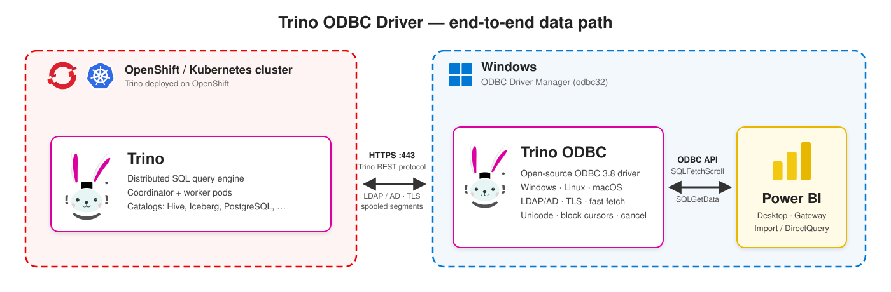

# Trino ODBC Sürücüsü

[](https://github.com/AhmetFurkanDEMIR/TrinoODBC/releases/latest)
[](LICENSE)


English: [README.md](README.md)

[Trino](https://trino.io/) için C++17 ile sıfırdan yazılmış, ANSI ve Unicode giriş noktalarına
sahip bir ODBC 3.8 sürücüsü. Temel hedef Power BI Desktop ve Power BI Gateway ile sorunsuz
çalışmaktır. Excel, Tableau, pyodbc ve `isql` gibi diğer ODBC istemcileriyle de kullanılabilir.

> **Durum.** Yayımlanan paketler üç platformda da kurulup kullanıldı: Windows x64 (NSIS kurulum
> paketi, Windows sürücü yöneticisi, Power BI Desktop), Linux (`.deb` / `.rpm` / `.tar.gz`,
> unixODBC) ve macOS (`.pkg`, iODBC); kurulum, DSN, bağlantı ve sorgular doğrulandı.

## Mimari



## Özellikler

* **ODBC 3.8**: tüm çekirdek, seviye 1 ve seviye 2 fonksiyonlarının ANSI ve `W` (Unicode)
  biçimleri, gerçek tanımlayıcılar (ARD/APD/IRD/IPD), sütun ve satır bazlı bağlamalı blok
  imleçler, parça parça `SQLGetData`, yürütme anında veri gönderen parametreler (`SQLParamData` /
  `SQLPutData`) ve eksiksiz dönüşüm matrisi. İmleçler yalnızca ileri yönlü ve salt okunurdur.
* **Kimlik doğrulama**: yok, LDAP / Active Directory (TLS üzerinden HTTP Basic), JWT, Kerberos
  (SPNEGO), OAuth2 (harici tarayıcı akışı) ve istemci sertifikası (mTLS).
* **TLS**: `Full` / `CA` / `None` doğrulama kipleri, özel CA dosyası, Windows sertifika deposu,
  en düşük TLS sürümü, istemci sertifikaları, HTTP ve SOCKS proxy.
* **Yüksek hız**: Trino'nun spooled protokolü (`json`, `json+zstd`, `json+lz4`) ve paralel segment
  indirme, sınırlı bellekle arka planda ön-getirme, sütun bazlı tipli sayfalar; getirme yolunda
  hücre başına bellek ayırma yok.
* **Trino'ya özgü**: oturum özellikleri, roller, ek kimlik bilgileri, istemci etiketleri, saat
  dilimi, kaynak adı, `X-Trino-Set-*` başlıklarıyla oturum takibi, `USE`, hazırlanmış ifadeler ve
  isteğe bağlı işlem (transaction) desteği.
* **Varsayılan saat dilimi Europe/Istanbul** (bilinçli bir proje varsayılanı): oturum Türkiye
  saatiyle (UTC+03:00) çalışır ve `timestamp with time zone` değerleri İstanbul yerel saati olarak
  teslim edilir. Kurulum programları bunu belirtir ve varsayılan her zaman değiştirilebilir:
  Windows'ta DSN penceresinde `Europe/Istanbul` ile önceden doldurulmuş bir *Saat dilimi* kutusu
  vardır; macOS'ta kurulum programının ilk sayfası `TimeZone` anahtarını anlatır; her platformda
  DSN'de ya da bağlantı dizesinde `TimeZone=system` (işletim sisteminin saat dilimi) ya da başka
  bir IANA adı ve `TimestampWithTimeZoneMode=utc` ile değiştirilir
  ([docs/CONNECTION-OPTIONS.md](docs/CONNECTION-OPTIONS.md#default-time-zone-europeistanbul)).
* **Katalog fonksiyonları** (`SQLTables`, `SQLColumns`, `SQLGetTypeInfo`, ...) `system.jdbc.*`
  üzerinden çalışır. `SQLColumns` ile `SQLDescribeCol` her zaman aynı tipleri bildirir.
* **ODBC kaçış dizileri** (`{fn}`, `{d}`, `{t}`, `{ts}`, `{interval}`, `{oj}`, `{escape}`,
  `{call}`) Trino SQL'ine çevrilir.
* **Power Query özel bağlayıcısı** ([powerbi/](powerbi/README.md)): DirectQuery ve
  iyileştirilmiş sorgu katlama (query folding).
* **Mevcut DSN'ler çalışmaya devam eder**: Starburst/Simba sürücüsünün ve Trino JDBC URL'sinin
  anahtar adları takma ad olarak kabul edilir; mevcut bir DSN'de çoğu zaman yalnızca `Driver=`
  satırını değiştirmek yeterlidir.

## Platformlar

| Platform | Sürücü yöneticisi | Paket | Üreten betik | Durum |
|---|---|---|---|---|
| macOS | iODBC (varsayılan) veya unixODBC | `TrinoODBC-<sürüm>-macos-<mimari>.pkg` (Installer.app paketi) ve `.dmg` (paketi ve belgeleri içeren disk görüntüsü) | `packaging/macos/build_pkg.sh` | doğrulandı (iODBC paketi) |
| Linux | unixODBC (isteğe bağlı iODBC) | `.deb`, `.rpm`, `.tar.gz` | `packaging/linux/build_packages.sh` | doğrulandı (unixODBC) |
| Windows 10 1903+ / 11, x64 | Windows ODBC (`odbc32`) | `TrinoODBC-<sürüm>-windows-x64-setup.exe` | `packaging/windows/cross_build_mingw.sh` + `build_installer.sh` (macOS/Linux üzerinde) | doğrulandı, Power BI Desktop dahil |
| Windows x64 / x86 / arm64 | Windows ODBC (`odbc32`) | `TrinoODBC-<sürüm>-<mimari>.exe` (Inno Setup) | `packaging\windows\build.ps1 -Installer` (MSVC + vcpkg) | henüz MSVC ile derlenmedi |

Her derleme tek bir sürücü yöneticisi içindir: `SQLWCHAR` iODBC'de 4 bayt, unixODBC ve Windows'ta
2 bayttır. macOS'ta grafik arayüzlü uygulamalar (Excel, Tableau) iODBC'yi; `isql`, pyodbc ve R
ise unixODBC'yi kullanır.

## Doğrulanan platformlar

| Platform | Paket | Sürücü yöneticisi | Doğrulanan |
|---|---|---|---|
| Windows 10 / 11, x64 | NSIS kurulum paketi `TrinoODBC-<sürüm>-windows-x64-setup.exe` (mingw-w64 derlemesi) | Windows ODBC (`odbc32`) | test edildi, sorun yok: kurulum, DSN ve bağlantı dizesi, sorgular, tam Power BI Desktop testi (bağlanma, gezinme, önizleme, içe aktarma, yenileme, iptal) |
| Linux x86_64 ve arm64 | `.deb`, `.rpm`, `.tar.gz` | unixODBC | test edildi, sorun yok: kurulum ve kayıt, DSN ve bağlantı dizesi, sorgular |
| macOS, Apple silicon | `.pkg` | iODBC | test edildi, sorun yok: kurulum ve kayıt, DSN ve bağlantı dizesi, sorgular |
| Otomatik testler (macOS ve Linux) | derleme dizini | iODBC, unixODBC | 384 birim testi; Python mock sunucusuna ve gerçek bir Trino 483'e karşı, düz HTTP ile ve HTTPS + parola ile kimlik doğrulama + spooled protokol ile 149 entegrasyon testi; macOS'ta ASan/UBSan derlemesi |

Paket satırları yayımlanan paketlerle Windows, Linux ve macOS (Apple silicon) üzerinde, tam bir
Power BI Desktop testi dahil, proje sorumlusu tarafından test edildi; sorun bulunmadı. Henüz
kapsanmayanlar: Windows için MSVC + Inno Setup yolu, Power BI Gateway ve gerçek sunuculara karşı
Kerberos, OAuth2 ve istemci sertifikası (bkz. [Durum](#durum)).

## İndirme

Kurulmaya hazır paketler
[Releases sayfasında](https://github.com/AhmetFurkanDEMIR/TrinoODBC/releases) yayımlanır. Her sürümde
bir `SHA256SUMS` dosyası bulunur; kurmadan önce indirdiğiniz dosyayı doğrulayın.

| Platform | Dosya | Kurulum |
|---|---|---|
| Windows 10 1903+ / 11 / Server 2022+, x64 | `TrinoODBC-<sürüm>-windows-x64-setup.exe` | yönetici olarak çalıştırın (`/S` sessiz kurulum) |
| macOS 26 (Tahoe), Apple silicon | `TrinoODBC-<sürüm>-macos-arm64.pkg` ya da `.dmg` | çift tıklayın ya da `sudo installer -pkg <dosya> -target /` |
| Debian / Ubuntu, x86_64 ya da arm64 | `trino-odbc_<sürüm>_amd64.deb` / `_arm64.deb` | `sudo apt install ./<dosya>` |
| RHEL / Fedora / SUSE, x86_64 ya da aarch64 | `trino-odbc-<sürüm>-1.x86_64.rpm` / `.aarch64.rpm` | `sudo dnf install ./<dosya>` |
| Diğer Linux | `trino-odbc-<sürüm>-linux-<mimari>.tar.gz` | açın, ardından `packaging/linux/register_driver.sh` |

macOS paketi Apple silicon üzerinde macOS 26 (Tahoe) ile üretilmiştir: içine konan Homebrew
kütüphaneleri bu en düşük sürümü taşır; daha eski bir macOS'ta ya da Intel Mac'te paketi
`packaging/macos/build_pkg.sh` ile kaynak koddan üretin ([docs/INSTALL-MACOS.md](docs/INSTALL-MACOS.md)). Paketler kod imzalı ya da noter onaylı değildir:
macOS ilk açılışta onay ister (sağ tık > *Aç*, ya da *Sistem Ayarları* > *Gizlilik ve Güvenlik* >
*Yine de Aç*), Windows SmartScreen ise *Daha fazla bilgi* > *Yine de çalıştır* gösterir.

## Hızlı başlangıç

Yukarıdaki paketler bu depodan [`packaging/`](packaging/) altındaki betiklerle üretilir. Her betik
sürücüyü derler, birim testlerini çalıştırır ve paketi `dist/` altına yazar. Aşağıdaki derleme
adımları yalnızca paketi yeniden üretmek için gerekir; aksi halde paketi indirip doğrudan kurulum
satırına geçin. Dosya adlarındaki `1.0.0` sürümünü ve mimariyi kullandığınız sürümle değiştirin.

### macOS

```sh
xcode-select --install
brew install cmake ninja simdjson zstd lz4 libiodbc
packaging/macos/build_pkg.sh              # dist/macos/TrinoODBC-<sürüm>-macos-<mimari>.pkg ve .dmg (iODBC)
sudo installer -pkg dist/macos/TrinoODBC-1.0.0-macos-arm64.pkg -target /   # ya da .pkg'ye çift tıklayın / .dmg'yi açın
"$(brew --prefix libiodbc)/bin/iodbctest" "Driver={Trino ODBC Driver};Host=trino.example.com;Port=8443;UID=jdoe;PWD=<parola>"
```

Paket sürücüyü `/Library/ODBC/TrinoODBC/` altına kurar ve *Trino ODBC Driver* adıyla
`/Library/ODBC/odbcinst.ini` dosyasına kaydeder. Installer.app içinde Trino logosunu, varsayılan
saat dilimini (Europe/Istanbul, UTC+03:00) ve nasıl değiştirileceğini (DSN'de `TimeZone`)
anlatan bir karşılama sayfasını, lisansı ve DSN örneği içeren bir özet sayfasını gösterir (Türkçe
bir Mac'te Türkçe). unixODBC kullanan istemciler için ikinci paketi
`--driver-manager unixodbc` ile üretin (`brew install unixodbc` gerekir); iki paket yan yana
kurulabilir. Ayrıntılar: [docs/INSTALL-MACOS.md](docs/INSTALL-MACOS.md).

### Linux

```sh
# Debian / Ubuntu derleme bağımlılıkları (RHEL / Fedora için docs/INSTALL-LINUX.md'ye bakın)
sudo apt-get install build-essential cmake ninja-build unixodbc unixodbc-dev odbcinst \
    libcurl4-openssl-dev libzstd-dev liblz4-dev libsimdjson-dev python3 tzdata
packaging/linux/build_packages.sh         # dist/linux/: her zaman .tar.gz; dpkg-deb / rpmbuild varsa .deb / .rpm
sudo apt install ./dist/linux/trino-odbc_1.0.0_amd64.deb
# ya da: sudo dnf install ./dist/linux/trino-odbc-1.0.0-1.x86_64.rpm
isql -v -k "Driver=Trino ODBC Driver;Host=trino.example.com;Port=8443;UID=jdoe;PWD=<parola>"
```

`.deb` ya da `.rpm` paketi kurulurken sürücüyü unixODBC'ye kaydeder, kaldırılırken kaydı siler.
`.tar.gz` arşivini açtıktan sonra `packaging/linux/register_driver.sh` betiğini çalıştırın.
Ayrıntılar: [docs/INSTALL-LINUX.md](docs/INSTALL-LINUX.md).

### Windows

x64 kurulum paketi macOS ya da Linux üzerinde mingw-w64 ve NSIS ile çapraz derlenir; paketi
üretmek için Windows makinesi gerekmez:

```sh
brew install mingw-w64 cmake ninja makensis   # Debian/Ubuntu: apt install mingw-w64 cmake ninja-build nsis
packaging/windows/cross_build_mingw.sh        # bağımsız trinoodbc.dll, objdump ile denetlenip hazırlanır
packaging/windows/build_installer.sh          # dist/windows/TrinoODBC-<sürüm>-windows-x64-setup.exe
```

Windows üzerinde:

1. `TrinoODBC-1.0.0-windows-x64-setup.exe` dosyasını yönetici olarak çalıştırın (`/S` sessiz
   kurulum yapar). Kurulum sürücüyü, belgeleri ve Power BI bağlayıcısını kurar ve
   *Trino ODBC Driver* kaydını oluşturur.
2. 64-bit *ODBC Veri Kaynağı Yöneticisi*'ni (`C:\Windows\System32\odbcad32.exe`) açın ve
   *Sistem DSN* > *Ekle* > *Trino ODBC Driver* yolunu izleyin. Sunucu, port, kimlik doğrulama,
   kullanıcı adı ve SSL ayarlarını girip *Test connection* düğmesine basın.

MSVC ve vcpkg ile yerel derleme (`packaging\windows\build.ps1 -Installer`, Inno Setup) de
sağlanmıştır, ancak henüz denenmedi; dağıtılan paket mingw-w64 / NSIS paketidir.
Ayrıntılar: [docs/INSTALL-WINDOWS.md](docs/INSTALL-WINDOWS.md) ve
[packaging/windows/README-installer.md](packaging/windows/README-installer.md).

### Bağlantı dizesi

```
Driver={Trino ODBC Driver};Host=trino.example.com;Port=8443;AuthenticationType=LDAP;UID=jdoe;PWD=<parola>;SSL=1;Catalog=iceberg;Schema=default
```

`PWD` verildiğinde `AuthenticationType=LDAP` kendiliğinden seçilir. Kimlik bilgisi verildiğinde
`SSL=1` de otomatik açılır; `AllowInsecurePassword=1` ya da açıkça `SSL=0` verilmişse açılmaz.
`Port` verilmezse SSL ile `443`, SSL olmadan `8080` kullanılır. Trino'nun HTTPS portu çoğunlukla
`8443` olduğundan `Port` değerini açıkça yazın. Takma adları ve varsayılanlarıyla tüm anahtarlar:
[docs/CONNECTION-OPTIONS.md](docs/CONNECTION-OPTIONS.md).

## 5 adımda Power BI

Sürücü, kurulan paketle Windows x64 üzerinde Power BI Desktop'tan kullanıldı. 5. adımdaki özel
bağlayıcı ve Power BI Gateway ayrıca doğrulanmadı.

1. **64-bit** sürücüyü Power BI Desktop'ın çalıştığı bilgisayara, Gateway kullanıyorsanız
   Gateway sunucusuna da kurun.
2. 64-bit ODBC yöneticisinde bir **Sistem DSN** oluşturun: sunucu, port `8443`, kimlik doğrulama
   `LDAP`, `SSL=1`; sunucu sertifikası kurumsal bir CA'dan geliyorsa `TrustedCerts`. Parolayı
   DSN'e kaydetmeyin; Power BI kendisi soracaktır.
3. Power BI Desktop'ta *Veri Al* > *ODBC* yolunu izleyip DSN'i seçin ya da *Gelişmiş seçenekler*
   alanına bağlantı dizesini yapıştırın.
4. Kimlik bilgisi penceresinde *Veritabanı* sekmesini seçip Active Directory kullanıcı adınızı ve
   parolanızı girin (Kerberos için *Windows* sekmesini seçin).
5. Gezgin'de tabloları seçip *Yükle*'ye basın. DirectQuery ve daha iyi sorgu katlama için
   `TrinoODBC.mez` özel bağlayıcısını kullanın: `-setup.exe` kurulum paketi onu
   `Documents\Power BI Desktop\Custom Connectors` klasörüne kopyalar; Power BI'da sertifikasız
   bağlayıcılara izin verilmelidir (*Seçenekler* > *Güvenlik* > *Veri Uzantıları*). Bkz.
   [powerbi/README.md](powerbi/README.md).

Gateway, büyük modeller ve sorun giderme: [docs/POWERBI.md](docs/POWERBI.md).

## Durum

* **Windows x64**: mingw-w64 çapraz derlemesinden (`cross_build_mingw.sh` + `build_installer.sh`)
  üretilen NSIS paketi proje sorumlusu tarafından kurulup kullanıldı: Windows sürücü yöneticisi
  sürücüyü yüklüyor, DSN ve bağlantı dizeleri (HTTPS dahil) bağlanıyor, sorgular veri döndürüyor
  ve Power BI Desktop sürücü üzerinden veri okuyor. MSVC + vcpkg ile yerel derleme ve onun Inno
  Setup kurulum paketi (`packaging/windows/build.ps1`, `installer.iss`) henüz çalıştırılmadı.
* **Linux ve macOS**: `.deb`, `.rpm` ve `.tar.gz` paketleri (unixODBC) ile `.pkg` (iODBC) proje
  sorumlusu tarafından kurulup kullanıldı. 384 birim testi ve 149 testlik entegrasyon paketi hem
  Python mock sunucusuna hem de gerçek bir Trino 483'e karşı geçiyor: düz HTTP ile, ayrıca HTTPS
  + parola ile kimlik doğrulama ve spooled protokol (`json+zstd` / `json+lz4` segmentleri
  MinIO'da) ile; macOS'ta ASan/UBSan derlemesi de geçiyor.
* **Kimlik doğrulama**: `None` ve `LDAP` (parola) doğrulandı. Kerberos, OAuth2 ve istemci
  sertifikası uygulanmış olsa da gerçek bir KDC, kimlik sağlayıcı ya da mTLS sunucusuna karşı
  denenmedi.
* **Power BI**: Windows x64 üzerinde Power BI Desktop ile tam test edildi (bağlanma, gezinme,
  önizleme, içe aktarma, yenileme, iptal); sorun bulunmadı. `TrinoODBC.mez` özel bağlayıcısı
  isteğe bağlıdır; Power BI Gateway ayrıca test edilmedi.

Tek bir Apple M serisi dizüstü bilgisayarda, Trino ve MinIO aynı makinede Docker içinde çalışırken
ölçüldü (`tpch.sf1.orders`, 1,5 milyon satır, 9 sütun); bunlar tekil ölçümlerdir, kapsamlı bir
kıyaslama değildir:

| Yol | Hız |
|---|---|
| Klasik JSON protokolü, düz HTTP | yaklaşık 300 bin satır/sn |
| TLS üzerinden spooled protokol | 1,5 - 2,6 milyon satır/sn |
| TLS ve spooling ile Power BI tarzı içe aktarma akışı | yaklaşık 1,57 milyon satır/sn |

Gerçek ağ gecikmesi, sunucu yükü ve spooling ayarları bu sayıları belirgin biçimde değiştirir.
Windows'ta hız ölçümü yapılmadı. Ayrıntılar: [docs/PERFORMANCE.md](docs/PERFORMANCE.md).

## Kaynak koddan derleme

```sh
cmake -S . -B build -G Ninja -DCMAKE_BUILD_TYPE=Release   # -DTRINO_ODBC_DRIVER_MANAGER=auto|unixodbc|iodbc|windows
cmake --build build
ctest --test-dir build --output-on-failure               # birim testleri + mock sunucuya karşı entegrasyon testleri
```

Bağımlılıklar: libcurl (zorunlu), simdjson (sistem paketi ya da otomatik indirme), isteğe bağlı
zstd ve lz4, seçilen sürücü yöneticisinin başlık dosyaları. Mock sunucu için `python3` gerekir.
`tests/docker/run_trino_tests.sh` entegrasyon testlerini Docker'daki gerçek bir Trino'ya karşı
çalıştırır ([tests/docker/README.md](tests/docker/README.md)). Derleme seçenekleri, sanitizer
derlemeleri ve pull request kuralları [CONTRIBUTING.md](CONTRIBUTING.md) içindedir.

## Günlük kaydı (log)

DSN'de ya da bağlantı dizesinde `LogLevel=4` (isteğe bağlı olarak `LogPath=<klasör>`) verin ya
da tüm DSN ayarlarının önüne geçen `TRINO_ODBC_LOG_LEVEL=4` ortam değişkenini tanımlayın.
Varsayılan dosya Windows'ta `%TEMP%`, diğer sistemlerde `$TMPDIR` (ya da `/tmp`) altındaki
`trino_odbc_<pid>.log` dosyasıdır. Parolalar, belirteçler ve ek kimlik bilgileri günlüğe asla
yazılmaz. Bkz. [docs/TROUBLESHOOTING.md](docs/TROUBLESHOOTING.md).

## Depo yapısı

```
src/         sürücü kaynakları: odbc/ (dışa aktarılan SQL* fonksiyonları), core/, client/, result/,
             convert/, types/, catalog/, sql/, util/, platform/ (Windows ve Unix'e özgü kod)
tests/       unit/, integration/ (ODBC API testleri), mock_trino/ (Python mock sunucu),
             docker/ (Ubuntu derlemesi ve gerçek Trino test ortamları)
docs/        kullanıcı belgeleri; docs/design/ katkıda bulunanlar için tasarım notlarını içerir
packaging/   macos/ (.pkg, .dmg), linux/ (.deb, .rpm, .tar.gz), windows/ (çapraz derleme, NSIS ve Inno Setup),
             assets/ (Trino logosu ve ondan üretilen kurulum simgeleri ve görselleri)
powerbi/     Power Query özel bağlayıcısı (TrinoODBC.pq, TrinoODBC.mez olarak paketlenir)
tools/       trino_odbc_bench hız ölçüm aracı
cmake/       CMake yardımcıları ve mingw-w64 araç zinciri dosyası
```

## Belgeler

Ayrıntılı belgeler İngilizcedir.

| Belge | İçerik |
|---|---|
| [docs/INSTALL-MACOS.md](docs/INSTALL-MACOS.md), [docs/INSTALL-LINUX.md](docs/INSTALL-LINUX.md), [docs/INSTALL-WINDOWS.md](docs/INSTALL-WINDOWS.md) | kurulum, kayıt, DSN, doğrulama |
| [docs/CONNECTION-OPTIONS.md](docs/CONNECTION-OPTIONS.md) | takma adları, varsayılanları ve örnekleriyle tüm bağlantı anahtarları |
| [docs/LDAP-AD.md](docs/LDAP-AD.md) | Active Directory: Trino sunucu ayarları, sürücü ayarları, sorun giderme |
| [docs/SSL.md](docs/SSL.md) | TLS doğrulama kipleri, kurumsal CA, istemci sertifikaları |
| [docs/POWERBI.md](docs/POWERBI.md) | Power BI Desktop ve Gateway, özel bağlayıcı, sorgu katlama |
| [docs/PERFORMANCE.md](docs/PERFORMANCE.md) | ölçülen hızlar, spooling, ön-getirme, blok imleçler |
| [docs/TYPES.md](docs/TYPES.md) | Trino'dan ODBC'ye tip eşlemesi ve dönüşümler |
| [docs/TROUBLESHOOTING.md](docs/TROUBLESHOOTING.md) | günlük kaydı, SQLSTATE tablosu, sık karşılaşılan hatalar |
| [docs/ODBC-CAPABILITIES.md](docs/ODBC-CAPABILITIES.md) | `SQLGetInfo` değerleri, kaçış dizileri, imleç modeli, işlemler |
| [powerbi/README.md](powerbi/README.md) | Power Query özel bağlayıcısının derlenmesi ve kurulması |
| [packaging/windows/README-installer.md](packaging/windows/README-installer.md) | NSIS kurulum paketi: derleme, bileşenler, sessiz kurulum, Windows'ta denetim |
| [packaging/assets/README.md](packaging/assets/README.md) | logo, simgeler ve kurulum görselleri, yeniden üretilmeleri, ticari marka notu |
| [tests/docker/README.md](tests/docker/README.md) | Linux konteyner testleri ve gerçek Trino test ortamı |
| [docs/ARCHITECTURE-OVERVIEW.md](docs/ARCHITECTURE-OVERVIEW.md) | katkıda bulunanlar için kısa mimari özeti |
| [ARCHITECTURE.md](ARCHITECTURE.md) | tüm ayrıntılarıyla tasarım sözleşmesi |
| [docs/design/](docs/design/) | katkıda bulunanlar için modül bazında tasarım notları |
| [CONTRIBUTING.md](CONTRIBUTING.md) | derleme, testlerin çalıştırılması, katkı kuralları |
| [CHANGELOG.md](CHANGELOG.md) | sürüm geçmişi |

## Lisans

Apache License 2.0 ile lisanslanmıştır (bkz. [LICENSE](LICENSE)). Sürücünün ve paketlerinin
içerdiği üçüncü taraf bileşenler ve lisansları [THIRD-PARTY-NOTICES.md](THIRD-PARTY-NOTICES.md)
dosyasında listelenir. Yeniden dağıttığınız her ikili pakete bu dosyayı da ekleyin.

Bu bağımsız bir açık kaynak projesidir. Trino projesi, Starburst ya da Microsoft ile bağlantılı
değildir ve onlar tarafından onaylanmamıştır.

Kurulum programları, simgeler ve disk görüntüsü, Trino Software Foundation'ın ticari markası olan
Trino logosunu yalnızca Trino ile uyumluluğu belirtmek için kullanır; herhangi bir onay anlamı
taşımaz (bkz. [NOTICE](NOTICE) ve [packaging/assets/README.md](packaging/assets/README.md)).
